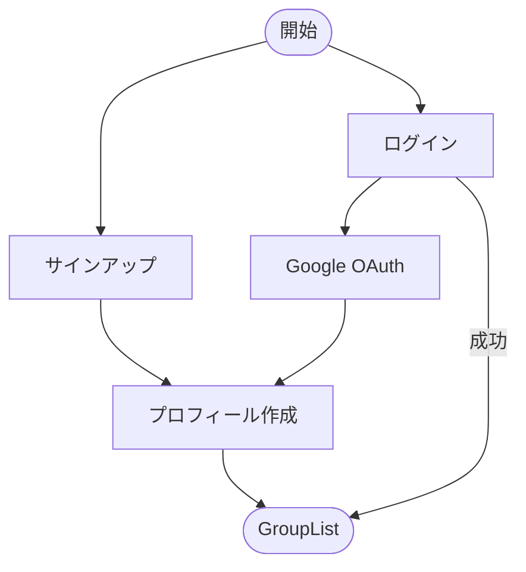
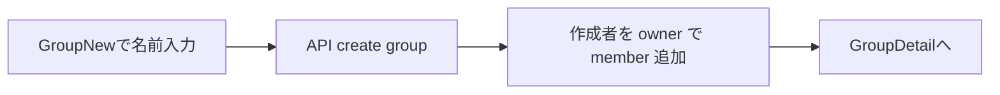
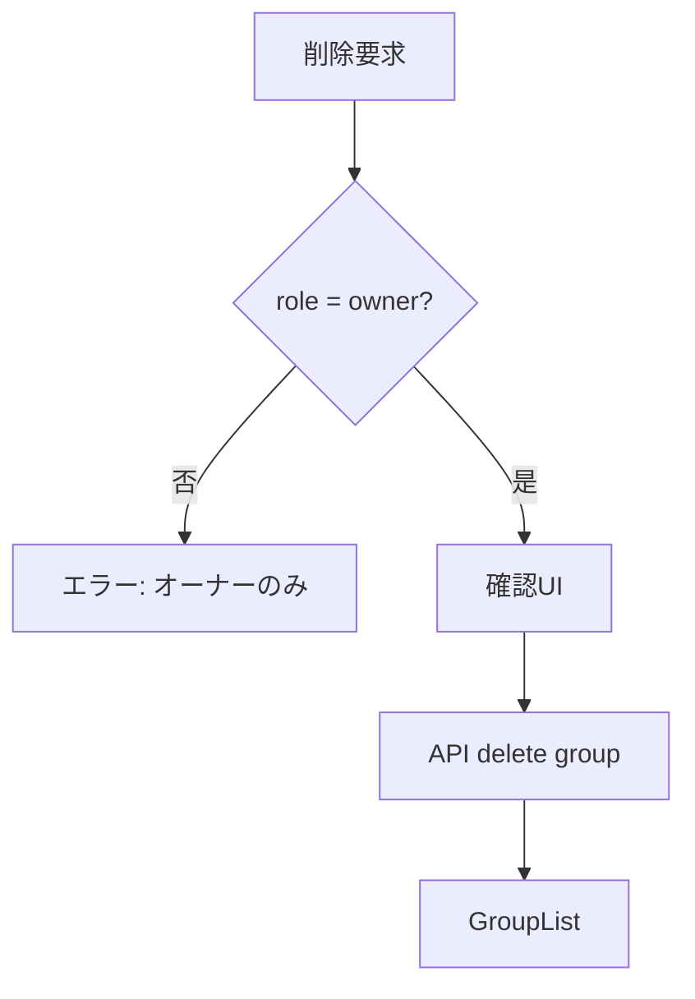
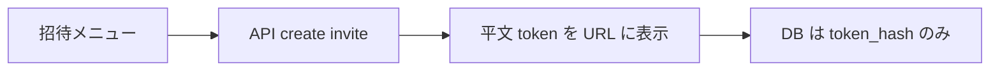
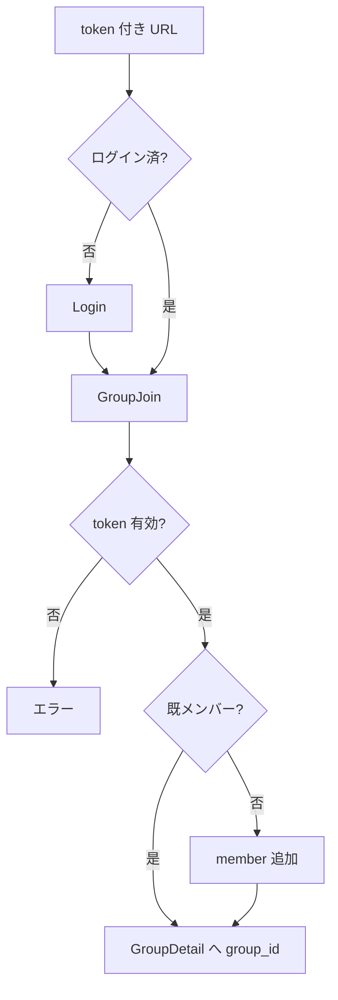
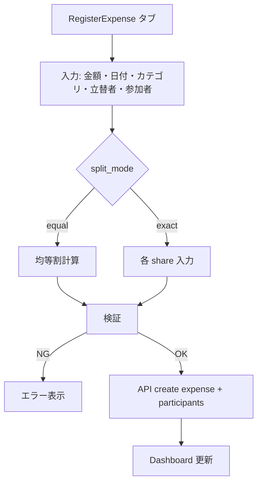
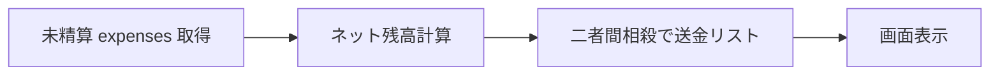
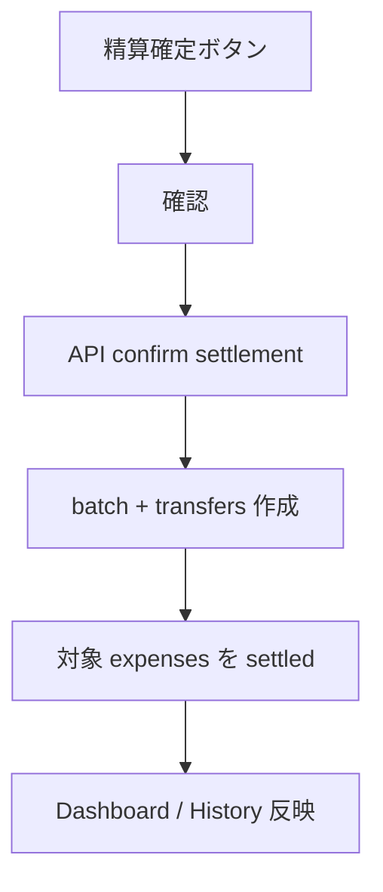
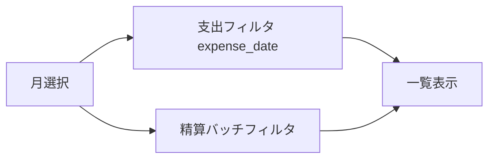
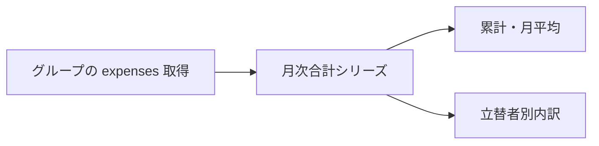

# 業務フロー

画面遷移は [screen-flow.md](./screen-flow.md)。ここでは **ユーザーが達成すること** と **守る判定** を固定する。

---

## 1. 認証（AUTH / PROF）

| 守る判定 |
|----------|
| 未認証は保護 API / 画面不可（401 → Login） |
| サインアップ成功時に `profiles` 相当行が存在 |
| 表示名更新は本人のみ |

---

## 2. グループ作成・削除（GRP / GRP-DEL）

### 作成

| 守る判定 |
|----------|
| 名前必須 |
| 作成者 = owner（自動） |

### 削除

| 守る判定 |
|----------|
| owner のみ削除可 |
| 一覧・詳細メニューの両方から到達可 |

---

## 3. 招待（INV）

### 発行（owner）

### 参加

| 守る判定 |
|----------|
| 発行は owner のみ |
| 期限切れ・無効 token は拒否 |
| 既メンバーは冪等（再参加しない） |
| 未認証は参加不可 |

---

## 4. 支出登録（EXP / SPL）

### 割り勘ルール（業務上の正）

| ケース | ルール |
|--------|--------|
| equal・立替者が参加者に含まれる | 参加者で均等割、**端数は立替者** |
| equal・立替者が参加者に含まれない | 参加者のみ均等割、**端数のみ立替者** |
| exact | share は正整数、**合計 = amount** |

| 守る判定 |
|----------|
| amount は正の整数 |
| カテゴリは定義集合のみ |
| 参加者 1 人以上 |
| exact: 0 以下・合計不一致は拒否 |
| `client_request_id` 重複は二重作成しない |
| **settled 支出は編集・削除不可**（未精算のみ） |

---

## 5. 精算プレビューと確定（SET）

### プレビュー（Dashboard・未精算のみ）

| 守る判定 |
|----------|
| ネット残高の全ユーザー合計 = **0** |
| 相殺は **同一ペアの逆方向のみ**（三者連鎖はまとめない） |

### 確定

| 守る判定 |
|----------|
| 対象は **前回確定〜今回** の未精算（期間精算） |
| メンバーのみ実行可 |
| 未精算 0 件時の挙動は API 仕様で明示（エラー or 空 batch — 実装前に決定） |
| 確定は D1 `batch` で一括更新 |

---

## 6. 履歴（HIS）

| 守る判定 |
|----------|
| 月候補は settled / unpaid / batch の月をマージし降順 |
| **当月はデータがなくても選択肢に含む** |
| period 精算で `target_month` が null の batch は `period_ended_at` の月でフィルタ |

---

## 7. グラフ（CHT）

| 守る判定 |
|----------|
| メンバーのみ `/groups/:id/charts` 閲覧可 |
| 集計は `expense_date` の YYYY-MM |

---

## フロー × 画面対応

| 業務 | 主な画面 |
|------|----------|
| 認証 | Login, Signup |
| グループ | GroupList, GroupNew |
| 招待 | GroupDetail メニュー, GroupJoin |
| 支出 | GroupDetail RegisterExpense タブ |
| 精算 | GroupDetail Dashboard タブ |
| 履歴 | GroupDetail History タブ |
| グラフ | GroupCharts |

---

## 関連

- [communication.md](./communication.md) — 上記を HTTP / D1 に落としたシーケンス
