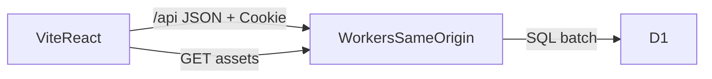
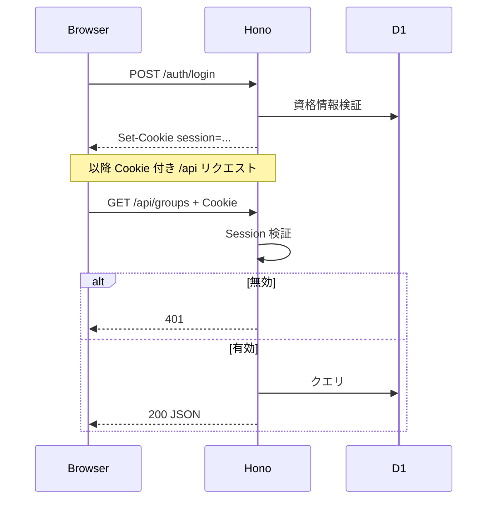
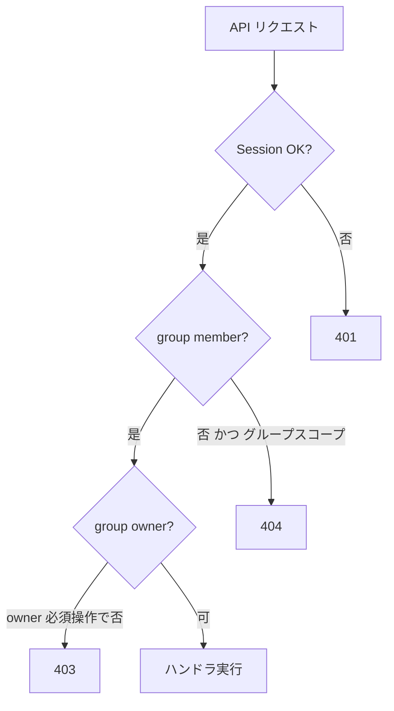
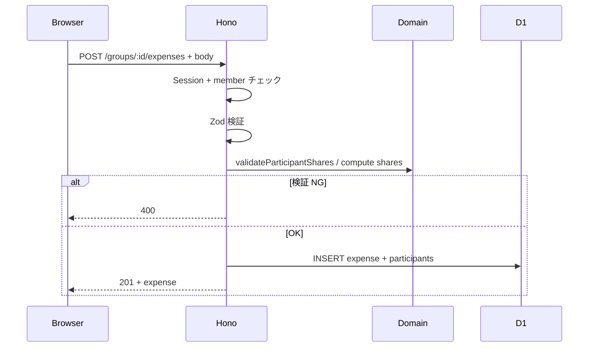
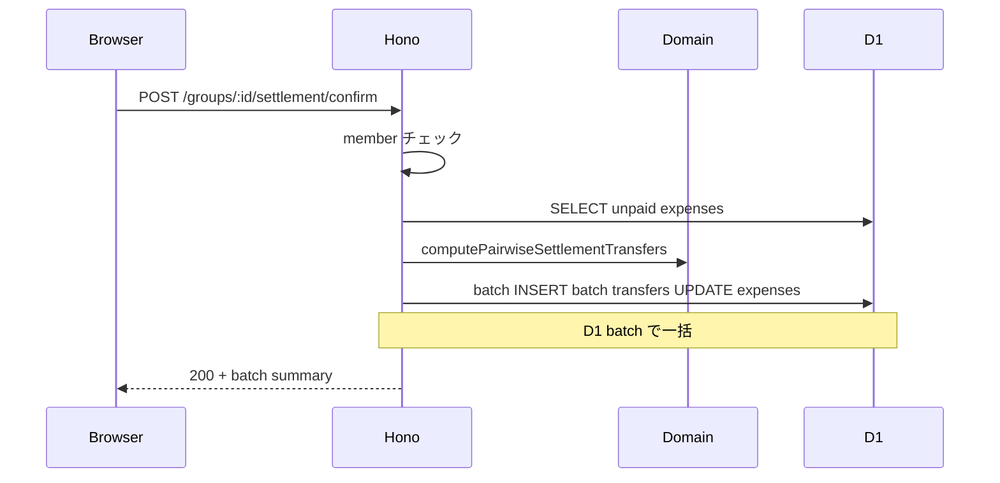
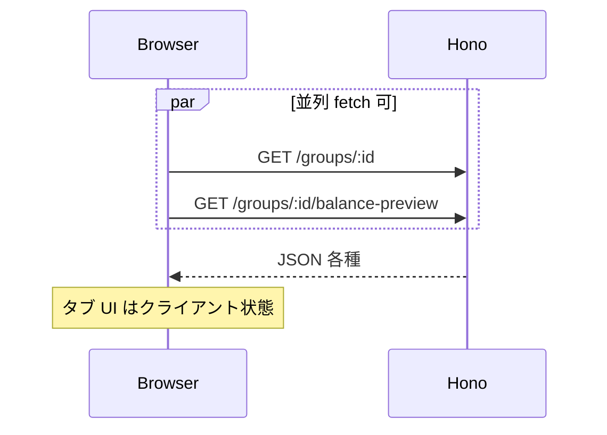

# 通信・API 境界

アーキテクチャ: **Vite + React** は **Hono（Cloudflare Workers）** のみと HTTP で通信。**D1 にはブラウザから直接接続しない**。

- **本番**: 静的ファイルと Hono は **同一 Workers オリジン**。ブラウザは `/api/*` のみ API 呼び出し。**CORS 不要**。
- **認証**: Cookie 名 `session`（HttpOnly）。詳細は [requirements-and-tech.md](../requirements-and-tech.md) §6.1.1。
- 認可（member / owner）は **API 層**（現行 RLS の置き換え）。

---

## レイヤ責務

| 層 | 責務 |
|----|------|
| React | 表示・入力・ルーティング・fetch・エラー表示 |
| Hono | 認証検証、認可、Zod 検証、ドメイン計算、D1 アクセス |
| D1 | 永続化、制約、マイグレーション |

---

## 認証の付与（概念）

Google OAuth も **`/api/auth/oauth/callback` が同じ `session` Cookie を発行**。

---

## 認可パターン

| 操作例 | 認可 |
|--------|------|
| GET `/groups/:id` | member |
| DELETE `/groups/:id` | owner |
| POST `/groups/:id/invites` | owner |
| POST `/groups/join` | ログイン済 + valid token |
| POST `/groups/:id/expenses` | member |
| POST `/groups/:id/settlement/confirm` | member |
| GET `/groups/:id/charts-data` | member |

非メンバーが `:id` を推測 → **404**（403 より情報を出さない方針）。

---

## エンドポイント草案（画面ドキュメントとの対応）

実装時のたたき台。メソッド・パスは変更可。

| 画面 / 業務 | メソッド | パス（案） | D1 触る |
|-------------|----------|------------|---------|
| Login | POST | `/api/auth/login` | users / sessions |
| Signup | POST | `/api/auth/signup` | users, profiles |
| Logout | POST | `/api/auth/logout` | sessions |
| OAuth callback | GET | `/api/auth/oauth/callback` | users, profiles |
| プロフィール更新 | PATCH | `/api/me/profile` | profiles |
| GroupList | GET | `/api/groups` | groups, members |
| GroupNew | POST | `/api/groups` | groups, members |
| GroupDetail 初期 | GET | `/api/groups/:id` | groups, members, unpaid expenses |
| GroupDetail Dashboard | GET | `/api/groups/:id/balance-preview` | expenses（未精算）→ **ドメイン計算は API 内** |
| 支出作成 | POST | `/api/groups/:id/expenses` | expenses, participants |
| 支出更新 | PATCH | `/api/groups/:id/expenses/:eid` | 同上 |
| 支出削除 | DELETE | `/api/groups/:id/expenses/:eid` | 同上 |
| 精算確定 | POST | `/api/groups/:id/settlement/confirm` | batch, transfers, expenses **batch** |
| History | GET | `/api/groups/:id/history?month=` | expenses, batches |
| 招待発行 | POST | `/api/groups/:id/invites` | invites |
| GroupJoin | POST | `/api/invites/accept` | members, invites |
| GroupCharts | GET | `/api/groups/:id/charts` | expenses 集計 |
| グループ削除 | DELETE | `/api/groups/:id` | groups cascade |

精算ルール（割り勘・二者間相殺）は **共有ドメインモジュール**（Vitest 対象）と API の両方から呼ぶ。React にはビジネスロジックを置かない（プレビュー表示用の整形のみ可）。

---

## 代表シーケンス

### 支出登録

### 精算確定

### グループ詳細（初回ロード）

---

## URL（本番・ローカル）

| 環境 | 配信 | API |
|------|------|-----|
| 本番 | Workers 同一オリジン（静的 + `/api`） | 相対パス `/api/...`（CORS なし） |
| ローカル | Vite dev | Wrangler dev。Vite **proxy** で `/api` → Wrangler |

本番でフロントに API 原点の env は不要（相対 `/api`）。ローカルのみ proxy 設定。

---

## 関連

- [screen-flow.md](./screen-flow.md)
- [business-flows.md](./business-flows.md)
- [mock-brief.md](./mock-brief.md)
