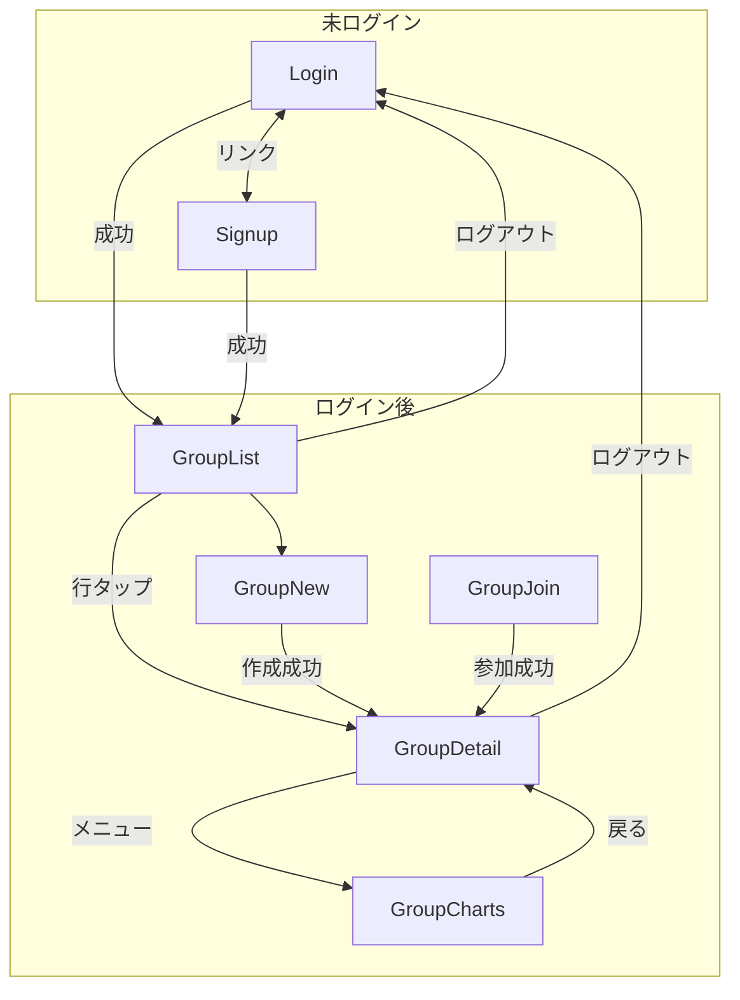
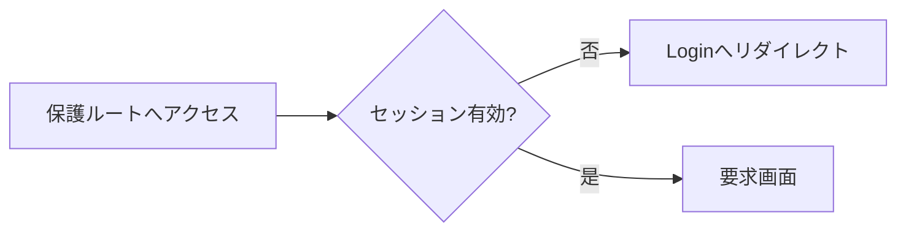
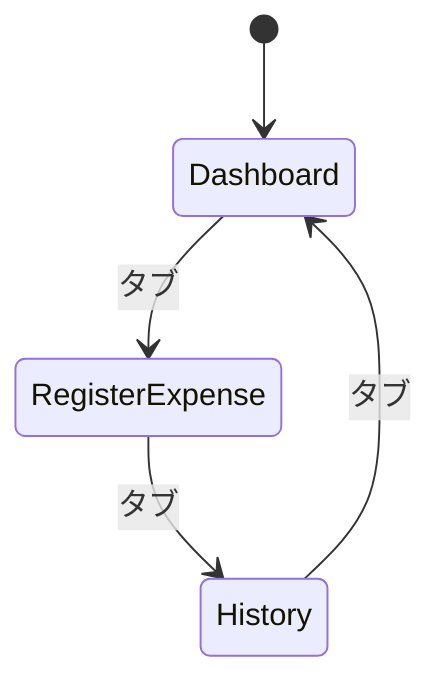
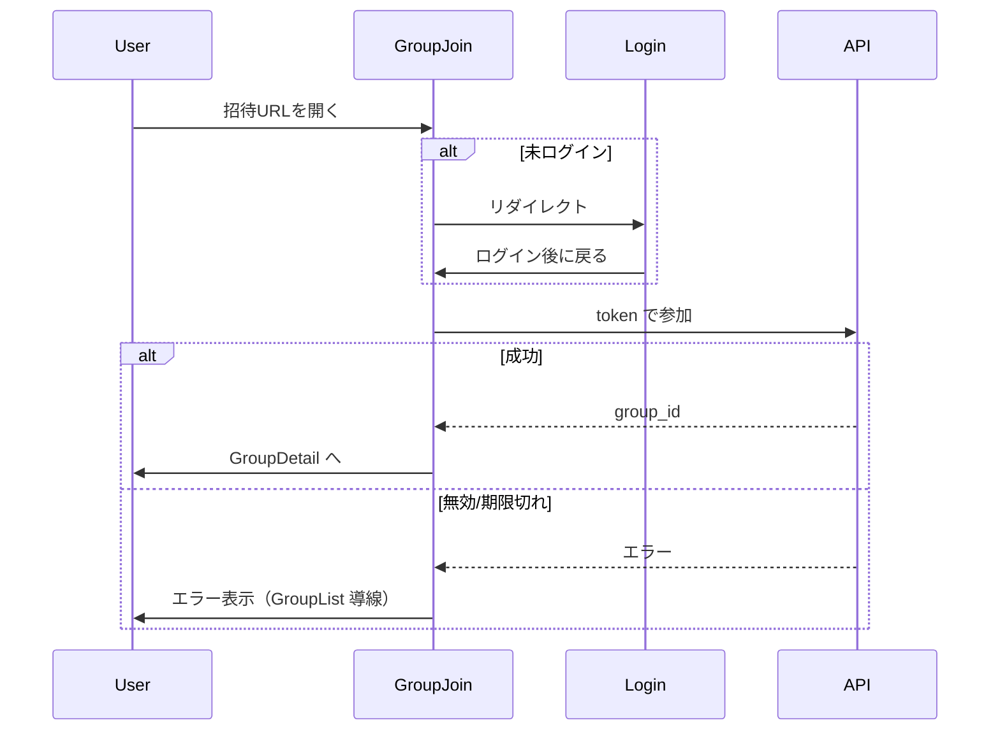

# 画面遷移

根拠: [behavior-inventory.md](../behavior-inventory.md)。再構築のルートは現行と同等を想定。

## 画面一覧（ルート 8）

| # | 画面 ID | パス | 要ログイン |
|---|---------|------|------------|
| 1 | Home | `/` | 任意（未ログインはログインへ誘導可） |
| 2 | Login | `/login` | 否 |
| 3 | Signup | `/signup` | 否 |
| 4 | GroupList | `/groups` | 是 |
| 5 | GroupNew | `/groups/new` | 是 |
| 6 | GroupJoin | `/groups/join?token=…` | 是 |
| 7 | GroupDetail | `/groups/:id` | 是 |
| 8 | GroupCharts | `/groups/:id/charts` | 是 |

グループ詳細（7）は **1 URL + タブ UI**。別ルートにしない。

## 全体遷移

## 認証ガード

- 保護: `/groups/**`
- 未ログインで `/groups/join?token=…` → ログイン後、トークン付き参加フローへ戻す（`next` 相当は実装時に決める）。

## グループ詳細（GroupDetail）

### タブ（同一 URL、クライアント状態または hash/query）

| タブ | 内容 |
|------|------|
| Dashboard | 未精算残高・送金プレビュー・月次精算確定導線 |
| RegisterExpense | 支出登録フォーム |
| History | 月フィルタ・支出一覧・精算バッチ履歴 |

### ヘッダーメニュー（⋮ 等）

| 項目 | 遷移 / 動作 | 条件 |
|------|-------------|------|
| チャート | `/groups/:id/charts` | メンバー |
| メンバー一覧 | シート / モーダル（同一画面内） | メンバー |
| 招待 | シート（URL 発行・コピー） | **owner のみ** |
| 表示名変更 | シート + 保存 | 本人 |
| ログアウト | 確認 → Login | 全員 |
| グループ削除 | 確認 → GroupList | **owner のみ**（一覧からも可） |

メンバーでない `:id` へのアクセス → **404 相当**（一覧に戻すか Not Found 画面。情報は出さない）。

## 招待参加フロー（画面遷移）

## 現行にないもの（スコープ外）

- PWA `/~offline`
- 支出編集専用フルページ（現行は詳細タブ / シート内編集 — 再構築でも **History または Dashboard からの編集 UI** で足りる。専用ルートは必須にしない）

## 関連

- 業務の中身: [business-flows.md](./business-flows.md)
- API 通信: [communication.md](./communication.md)
- 画面の役割一覧: [mock-brief.md](./mock-brief.md)
